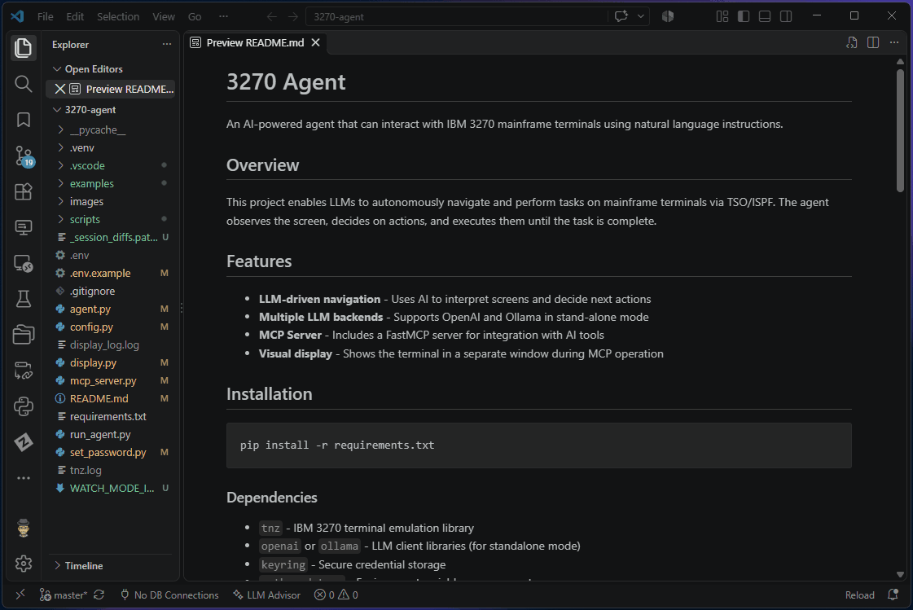

# 3270 Terminal

Native 3270 terminal for VS Code and Cursor. Hosts live in the activity bar. A session opens as an editor tab with a fixed 3270 grid, not a scrolling VT terminal.

TN3270, including extended colour and IND$FILE, is [IBM tnz](https://github.com/IBM/tnz). tnz and ebcdic are packaged in the extension, so there is nothing to pip install.

## Requirements

- Python 3.10 or later
- VS Code or Cursor 1.85+

## Connect

**Add Host** opens a settings tab. Ctrl+S saves. Connect from the host list, then log on in the 3270 screen. Passwords are not stored.

A new profile starts as plain telnet on port 23. Choosing TLS moves it to 992. One profile can have several sessions (**New Session**); a profile with an LU name can have only one, because the host will not share a pinned LU. Closing a tab disconnects. A tab left open across a window reload connects again and logs on — it does not resume the host session.

The screen size has to match the host's LU. If it is short, tnz drops the session. [Screen size](docs/SETTINGS.md#screen-size) says how to pick it.

Every profile field and every `tn3270.*` setting is in [docs/SETTINGS.md](docs/SETTINGS.md).

## Keys

While a 3270 tab has focus:

| Key | Action |
| --- | --- |
| F1–F12, Shift+F1–F12 | PF1–PF24 |
| Enter | ENTER |
| Alt+1 / Alt+2 / Alt+3 | PA1 / PA2 / PA3 |
| Alt+C or Pause | CLEAR |
| Alt+A, or Ctrl+C with nothing marked | ATTN |
| Ctrl+C / Ctrl+X / Ctrl+V | Copy / Cut / Paste a marked block |
| Drag, or Shift+arrows | Mark a rectangle |

Any binding can be changed, and an open session picks the change up on save. The full map, chord syntax, the wheel (PF7 and PF8), and clickable `F3=Exit` hotspots are in [docs/KEYMAP.md](docs/KEYMAP.md).

## In a session

- **Macros.** A tape (`=3.4[enter]`) or a Python script. A logon macro can wait for the panel and ask for the password, so it is never stored. [docs/MACROS.md](docs/MACROS.md)
- **IND$FILE.** Download and upload from TSO READY or ISPF option 6. [docs/TRANSFER.md](docs/TRANSFER.md)
- **Capture.** **3270 Terminal: Capture Screen** writes the current screen to a text file. A session log keeps writing until you stop it. Non-display fields are already blank, so a password cannot be captured. [docs/SETTINGS.md](docs/SETTINGS.md#capture-and-logging)

## Documentation

- [Settings](docs/SETTINGS.md)
- [Keyboard map](docs/KEYMAP.md)
- [Macros](docs/MACROS.md)
- [File transfer](docs/TRANSFER.md)
- [Changelog](CHANGELOG.md)
- [How it was built](HISTORY.md)

Apache-2.0. See [NOTICE](NOTICE) for the tnz and ebcdic attribution.

If this is useful, a rating helps other mainframers find it.
